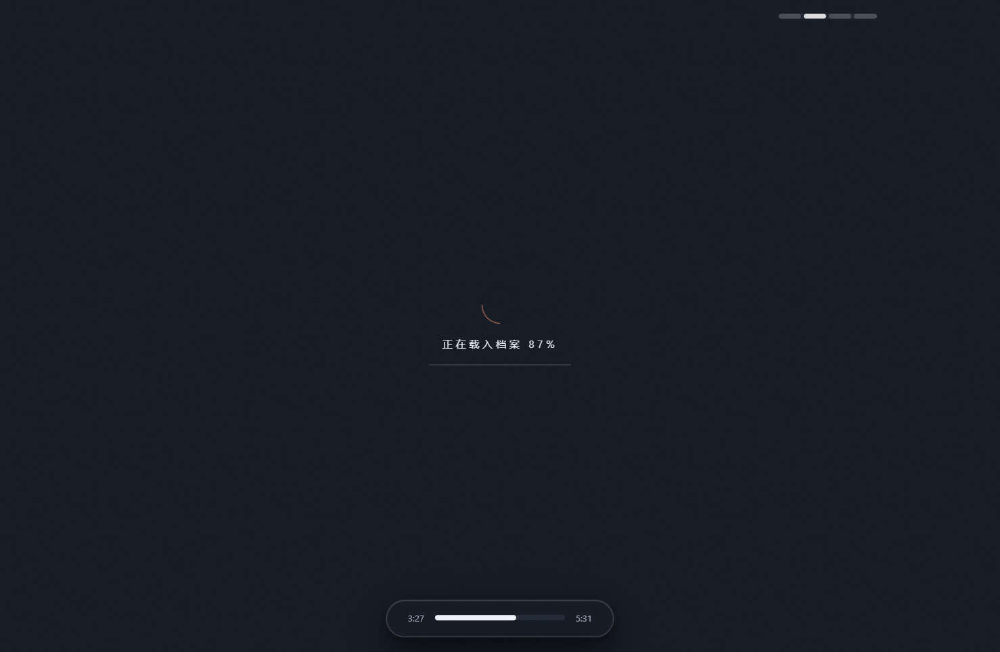
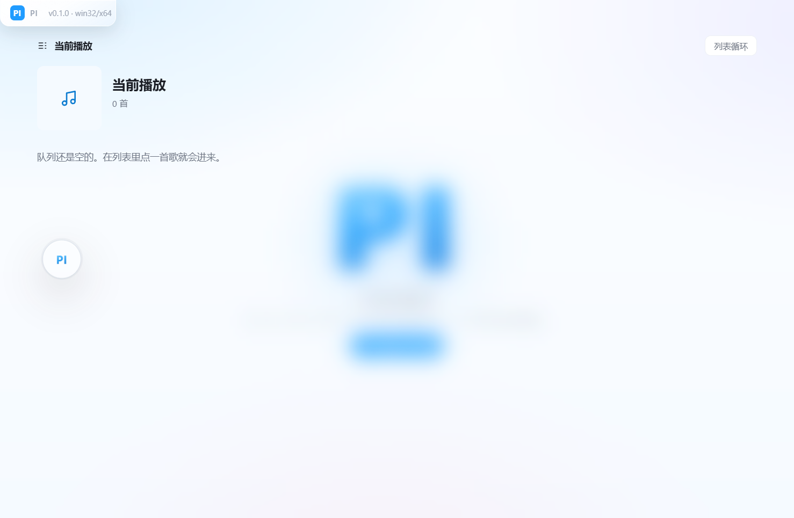
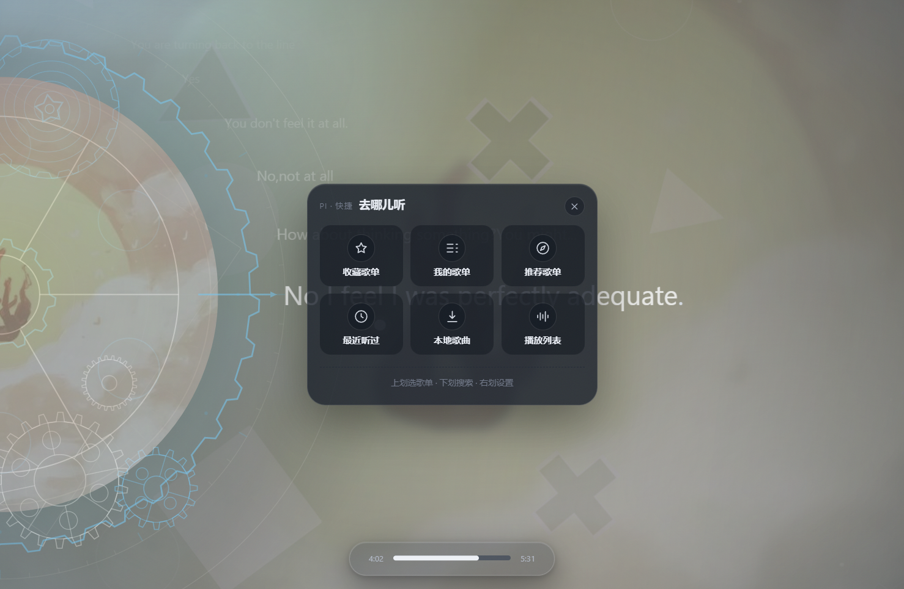
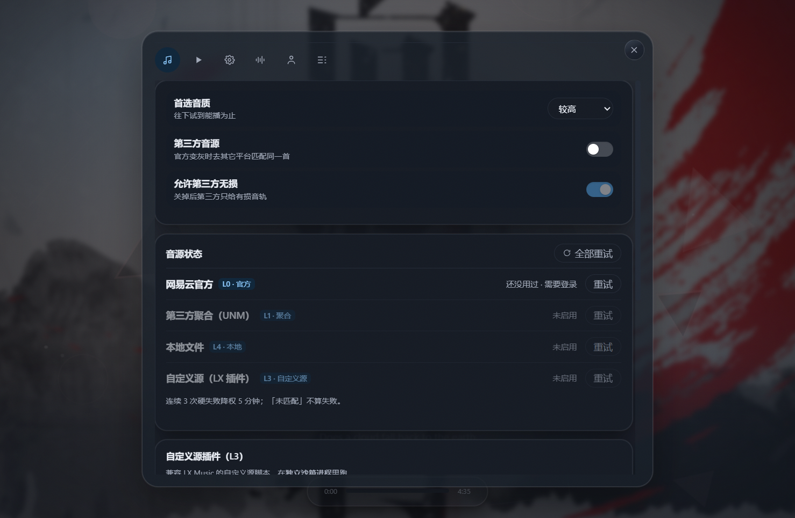
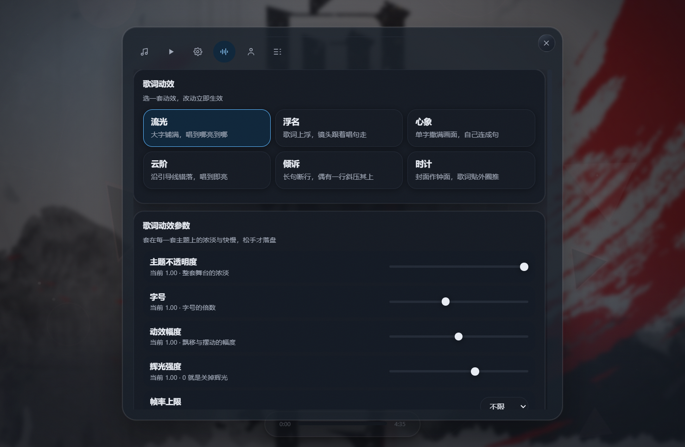

<p align="center">
  
</p>

<div align="center">

# PI

Music, Reimagined // 拾音新境

[](https://github.com/taosuuuw/PI_muisc/releases)
[](https://github.com/taosuuuw/PI_muisc/stargazers)
[](https://nodejs.org/)

[项目简介](#项目简介)
·
[主题预览](#部分歌词主题预览)
·
[核心能力](#核心能力)
·
[获取方式](#获取方式)
·
[开发文档](./docs/DEVELOPMENT.md)
·
[致谢](#致谢)

</div>

## 项目简介

PI 是一款以**全屏沉浸式歌词**和**多源音源解析**为核心的桌面音乐播放器，基于 Electron 与 React 构建，面向 Windows 桌面。

它接入网易云音乐的数据（歌曲 / 歌单 / 评论 / 登录），并在播放时按一条**五层责任链**尽可能拿到无损音源：官方接口 → 内嵌解锁 → 第三方聚合 → 你导入的 LX 自定义源 → 本地文件夹。每一层的实际音质都用 HTTP Range 嗅探文件头**实测**，而不是相信接口的自称。

歌词是这个项目的重心。全屏歌词页提供**九套动效主题**（流光 / 浮名 / 心象 / 云阶 / 倾诉 / 时计 / 莫奈 / 凝彩 / 商籁），每套都有独立的排版氛围与逐字动效，并暴露 **18 个可调参数**；配合按歌词情绪与封面色彩生成的**沉浸式背景**，让全屏歌词拥有接近文字 PV 的观感，同时自动适配任意窗口尺寸。

歌词来源同样不止一条：内置 **六条歌词源**（网易云 / AMLL TTML / QQ QRC / 酷狗 / Lrclib / 本地文件），可逐源开关，其中 QQ 的 QRC 是**真·逐字**时间戳。主源都没命中时还有一层**兜底源**（Lrclib）顶上，所以冷门歌也不至于空着。

界面上有**两套排版**：**平凡**是整行竖排列表，**先锋**是队列拼贴墙，播放页空白处点出 `PI` 键左划即切换。
先锋档里还有**两套皮肤**（设置 →「界面」→「先锋风格」）：**队列拼贴**（封面卡片流 + 拼贴墙）与
**莱茵风**（一列列波浪流动的 CD 盒阵列：总览看列名牌、近景看右侧详情栏、放大看完整曲目单）。

## 展示


### 部分歌词主题预览

九套主题不逐一亮相，挑四套风格差得最开的看看：

<table>
  <tr>
    <td width="50%">
      
    </td>
    <td width="50%">
      
    </td>
  </tr>
  <tr>
    <td align="center"><strong>流光</strong> · classic</td>
    <td align="center"><strong>浮名</strong> · fume</td>
  </tr>
  <tr>
    <td width="50%">
      
    </td>
    <td width="50%">
      
    </td>
  </tr>
  <tr>
    <td align="center"><strong>莫奈</strong> · monet</td>
    <td align="center"><strong>凝彩</strong> · tempera</td>
  </tr>
</table>

其余五套（心象 `cadenza` / 云阶 `partita` / 倾诉 `tilt` / 时计 `pendolo` / 商籁 `sonnet`）在设置页的
「歌词」一栏里都能直接切换预览。

不同的歌词动画有不同的排版氛围和可调参数，并可随窗口尺寸自适应铺满，全屏与窗口模式下都不会溢出或裁切。

### 其它界面

<table>
  <tr>
    <td width="50%">
      
    </td>
    <td width="50%">
      
    </td>
  </tr>
  <tr>
    <td align="center"><strong>我的喜欢 · 拼贴墙</strong></td>
    <td align="center"><strong>点出 PI 键 · 六块按键卡</strong></td>
  </tr>
  <tr>
    <td width="50%">
      
    </td>
    <td width="50%">
      
    </td>
  </tr>
  <tr>
    <td align="center"><strong>设置边框页</strong></td>
    <td align="center"><strong>歌词动效参数</strong></td>
  </tr>
</table>

## 核心能力

| 模块 | 说明 |
| --- | --- |
| 在线搜索与播放 | 搜索歌曲、歌手或专辑后即可播放，自动加载封面与歌词。 |
| 五层音源解析链 | L0 官方接口 → L1 内嵌解锁 → L2 第三方聚合 → L3 你导入的 LX 自定义源 → L4 本地文件夹，逐层尝试，第一个「满足音质且通过字节嗅探」的结果胜出。 |
| 音质实测而非自称 | 用 HTTP `Range` 取文件头嗅探容器与采样率（`fLaC` / `ID3` / `ftyp` / `OggS`），来源自称与实测不符时明确显示「标称 X，实测只到 Y」。 |
| 全屏歌词 · 九套动效主题 | 流光 `classic` / 浮名 `fume` / 心象 `cadenza` / 云阶 `partita` / 倾诉 `tilt` / 时计 `pendolo` / 莫奈 `monet` / 凝彩 `tempera` / 商籁 `sonnet`，各自动效与排版骨架独立。 |
| 歌词动效参数 | 18 个可调旋钮（主题透明度 / 字号比例 / 动势 / 辉光 / 背景辉光 / 帧率上限 / 每曲随机主题 / 浮名相机跟随 / 流光逐字旋转 / 云阶分栏与错峰 / 时计表盘半径 · 张角 · 逃逸力 · 焦点缩放 · 封面入盘）外加一键复位。 |
| 六源歌词 + 兜底 | 网易云 / AMLL（TTML）/ QQ（QRC，逐字）/ 酷狗 / Lrclib / 本地文件逐源可开关；主源全部不达标时由**兜底源**（Lrclib）再兜一次。 |
| 逐字歌词 | QQ QRC 是真正的逐字时间戳（不是按行均分）；其余来源没有逐字信息时按行时长均分兜底，界面不会假装自己有逐字。 |
| 沉浸式情绪背景 | 用 6 族 87 条中英情绪词典（63 条中文 + 24 条英文）给歌词打分，配合封面取色生成背景构图——**纯本地，不依赖任何联网 LLM**。 |
| 两套排版 · 卡片化列表 | 平凡 `plain` = 竖排列表，先锋 `avant` = 队列拼贴墙；「我的喜欢」在先锋档是一面可无限拖拽的拼贴墙（悬停互动、点击放大填屏、拖到底自动翻页）。先锋档另有一套皮肤**莱茵风**：波浪流动式 CD 盒阵列（Three.js），列 = 歌单、行 = 曲目，三层界面依次是列名牌 / 右侧详情栏 / 完整曲目单，替代歌单封面卡片导航、歌单页歌曲选择导航与队列拼贴放大封面的界面。见 [docs/RHINE-SKIN.md](./docs/RHINE-SKIN.md)。 |
| 歌单编辑 | 自己的歌单与本地播放列表可**删歌**（点列表封面进入编辑态，每行左边浮现删除键）；本地播放列表还能**长按一行拖动改序**，云端歌单因官方没有排序接口而只支持删除。 |
| 灵动岛 | 顶部一颗「药丸 + 小球」的通知岛：加载歌曲时是「少女祈祷中⭐」、切换排版时是风格提示；多条通知同时存在时新的顶成药丸、旧的收成小球，形变是同一棵 DOM 上的过渡而不是重挂。 |
| 手势化操作 | 点空白处浮出 `PI` 键，**上划**六块按键卡 / **下划**搜索 / **右划**快捷设置 / **左划**切换平凡·先锋两套排版。 |
| 音质日志与健康降权 | 记录最近 200 次解析（含每个音源的成功 / 失败 / 耗时）；连续硬失败的音源自动降权 5 分钟，设置页可见可手动重试。 |
| 账号安全红线 | 登录 cookie 只发往 `127.0.0.1` 的内嵌服务，任何第三方音源都拿不到；LX 脚本跑在无 `require` / `process` / `fs` 的独立沙箱子进程里。 |
| 本地音乐 | L4 本地文件夹兜底匹配（歌名 + 歌手 + 时长硬条件），设置页有本地曲库区块与下载列表。 |
| 打包与安装 | 便携版绿色目录 + C# 自解压安装器；按用户安装、免管理员 / UAC、全程不落地任何临时文件。 |

## 获取方式

### 直接下载

- **Windows 安装包**：最新版本请前往 [Releases 页面](https://github.com/taosuuuw/PI_muisc/releases/latest) 下载
  `PI-Setup-<版本>.exe`，双击运行即可。安装到 `%LOCALAPPDATA%\Programs\PI`，**按用户安装，不需要管理员 / UAC**，
  并会登记到「设置 → 应用 → 已安装的应用」，可从那里卸载。

静默 / 脚本化安装：

```powershell
PI-Setup-<版本>.exe --silent --target "<安装目录>" --no-shortcuts
```

### 从源码构建

需要 Node.js `>= 22.12.0` 与 pnpm `10.x`：

```bash
pnpm install
pnpm electron:install   # 首次必须：下载 Electron 运行时（约 250MB）
pnpm dev                # 启动 Vite + Electron 开发环境
```

打包：

```bash
pnpm release            # 一条龙：build → dist → installer
pnpm dist               # 便携版 → release/pi/（绿色目录，双击 pi.exe 即跑）
pnpm installer          # 安装包 → release/PI-Setup-<版本>.exe
```

> 本仓库**不使用 npm**；所有命令都用 `pnpm`。更完整的环境要求、环境变量、
> 目录结构、架构约束与打包细节见 [开发文档](./docs/DEVELOPMENT.md)。

## 界面与操作

- **点空白处**浮出 `PI` 键，然后 **上划** 打开六块按键卡（收藏歌单 / 我的歌单 / 推荐歌单 / 最近听过 / 本地歌曲 / 当前播放），
  **下划** 打开搜索，**右划** 打开快捷设置，**左划** 在**平凡 / 先锋**两套排版之间切换。
- 播放页左下角是歌曲名片，**切歌时会脉冲一次**；右下是歌词轨道，滚轮只浏览歌词、**绝不改变播放进度**。
- 顶部那颗**灵动岛**会显示当前状态：加载歌曲时是「少女祈祷中⭐」，切换排版时是风格提示。
  两条通知同时出现时，新的顶成药丸、旧的缩成小球挂在旁边；新的消失后小球自己长回药丸——形变是同一棵 DOM 上的过渡，不是重新挂载。
- **我的喜欢**在先锋档是一面拼贴墙：悬停有描边与扫光，点击正在播放的那一格会放大填屏回到播放页，一直往下拖会自动翻页；
  在平凡档是一张铺满窗口的玻璃列表，左上角那枚**液态玻璃退出键**鼠标靠近才浮现（在里面点它回上一级歌单选择页）。
- **歌单编辑**：进到自己的歌单或本地播放列表的歌曲选择页，点左上那张**封面**即进入编辑态——每行左边浮现删除键；
  本地播放列表还能**长按一行拖动**改顺序（云端歌单没有这个能力，见下）。
- 窗口只有**最小化 / 最大化 / 关闭**三个键（`F11` 等同最大化）：刻意不做独占全屏，因为它会压住任务栏，
  而最大化既能铺满屏幕、又保留鼠标碰底边唤出自动隐藏任务栏的那条边。

## 更新日志

### v0.9.5 · 莱茵风收尾

这一版集中在**莱茵风**（先锋档里的 CD 盒阵列皮肤）的观感与手感：

- **暗色档重新调色**：玻璃壳、内页托盘、背景与半球光整体转冷——冰白 + 深蓝灰，替换掉原来偏米黄的暖调，向参考项目的冷色档案感靠。
- **底部换成播放器自己的进度条**：不再另造一个，直接复用播放页那个组件。拖动行为、上下首、音量都跟播放页完全一致（拖动时只挪填充、松手才 seek）。
- **右上角档位器重做**：常态收成一根四段细线（哪一段亮就是当前档位），鼠标悬停展开成胶囊；选中滑块在四段之间滑动，带一点点过冲。
- **点进度条可以回播放页**：点胶囊的空白或时间区回播放页，点轨道仍是 seek、点按钮仍是播放控制。
- 队列在近景 / 详情档**真正首尾相接**：滚到最后一首会接回第一首，不会凭空多出空位。
- **进入歌单直接落在选中曲目**，不再先滚一段才停。
- 修掉开场动画收尾时波浪形状突然翻转的跳变。
- 修掉某些情况下加载层停在 100% 不消失、画面冻在开场第一帧的问题。

## 现状与未完成

**照实说**，这是个还在长身体的版本：

- **云端歌单不能排序**：网易云没有开放「调整歌单内顺序」的接口（只有增 / 删），所以拖动改顺序只在**本地播放列表**上成立；云端歌单只支持删除。要硬做只能全删重加，那会丢播放量、还容易撞限流，所以没做。
- **逐字歌词只覆盖一部分来源**：QQ 的 QRC 是真逐字；网易云 / AMLL / 酷狗 / Lrclib / 本地文件没有逐字信息时按行时长均分兜底，界面不会假装自己有逐字。
- **音质上限取决于你手上的源**：官方接口能给什么就是什么，想要更高音质得自备 LX 自定义源或本地无损文件。
- 「主题颜色」只有明 / 暗 / 跟随系统，**不能换主色**（主色由专辑封面提色而来）。
- 本地曲库目前是「扫描文件夹 + 下载列表」，还没有更细的标签 / 专辑视图。
- 目前只提供 Windows 桌面端；没有移动端与 Web 版。
- 仓库内**没有 `LICENSE` 文件**，授权状况见下。

## 文档与开发

| 文档 | 内容 |
| --- | --- |
| [开发文档](./docs/DEVELOPMENT.md) | 环境变量、启动方式、构建与打包、目录结构、架构约束、音源体系、历轮改版记录 |
| [PLAN.md](./docs/PLAN.md) | 需求 → 架构 → 里程碑，以及全部决策过程 |
| [NEXT.md](./docs/NEXT.md) | 正在做 / 待办清单（含已知欠账与下一步计划） |
| [API-MAP.md](./docs/API-MAP.md) | 音源与接口清单 |
| [ADR/](./docs/ADR) | 架构决策记录 |
| [CREDITS.md](./docs/CREDITS.md) | **鸣谢与借鉴来源账本**——借了谁、借了什么、授权状况 |

## 法律与免责声明

本项目在 AI 的广泛协助下开发，因此仍可能存在细微或不易察觉的问题。若给你带来不便，敬请理解。

本项目主要用于展示播放动效、界面设计与相关工程实现。应用中涉及的在线音乐流媒体、歌词、专辑封面及其他内容，其版权均归对应权利人所有。

本仓库及其源代码仅供个人学习、技术交流与非营利测试使用。请勿将其用于商业盈利用途。若因对在线资源的传播、加工或再分发而引发版权纠纷或其他责任，均由使用者自行承担，项目开发者不承担相关责任。

请始终尊重数字版权，并在条件允许时通过官方平台支持正版音乐。

## 致谢

### 特别感谢

**[chthollyphile/folia-major](https://github.com/chthollyphile/folia-major)** —— PI 的界面与动效设计直接受益于这个项目。

PI 的全屏歌词页在版式骨架、逐字三态（字号 / 透明度 / 缩放 / 模糊 / 时长）、材质与阴影槽、
封面拼贴铺法，以及九套歌词主题（其中莫奈 `monet`、凝彩 `tempera`、商籁 `sonnet` 是明确复刻其
同名主题）的数值体系上，都参考并借鉴了 folia-major。
它让我们看清了「全屏歌词可以做到什么程度」。

必须说清楚的是：folia-major 采用 **AGPL-3.0**（强 copyleft）授权。PI 的做法是
**只借鉴不受版权保护的数值、参数与做法思路，代码全部自行实现，不复制其源码**；
其视觉设计与实现思路也给了我们很多启发。如果你也想参考它，请务必先读它的许可证。

以上借鉴的逐条明细、我们**采纳了什么 / 没有采纳什么**，都如实登记在 [CREDITS.md](./docs/CREDITS.md)。

### 其它致谢

folia-major 的致谢名单里点名的项目，本仓库同样登记在案：

- [chenmozhijin/LDDC](https://github.com/chenmozhijin/LDDC)
- [NeteaseCloudMusicApiEnhanced/api-enhanced](https://github.com/NeteaseCloudMusicApiEnhanced/api-enhanced)
- [chenglou/pretext](https://github.com/chenglou/pretext)
- [MakcRe/KuGouMusicApi](https://github.com/MakcRe/KuGouMusicApi)
- [paper-design/shaders](https://github.com/paper-design/shaders)
- [yakult-green-tea/qq-music-api](https://github.com/yakult-green-tea/qq-music-api)
- [amll-dev/amll-ttml-db](https://github.com/amll-dev/amll-ttml-db)
- [Widdit/now-playing-service](https://github.com/Widdit/now-playing-service)

以及音源链路上真正在干活的 [UnblockNeteaseMusic](https://github.com/UnblockNeteaseMusic/server)
与 LX Music 自定义源协议。感谢这些项目的作者与贡献者。

## 授权状况

本仓库**当前没有 `LICENSE` 文件**，即保留所有权利（All rights reserved）。
在补充许可证之前，请不要将其用于再分发或商业用途。详见 [CREDITS.md](./docs/CREDITS.md) §4。
